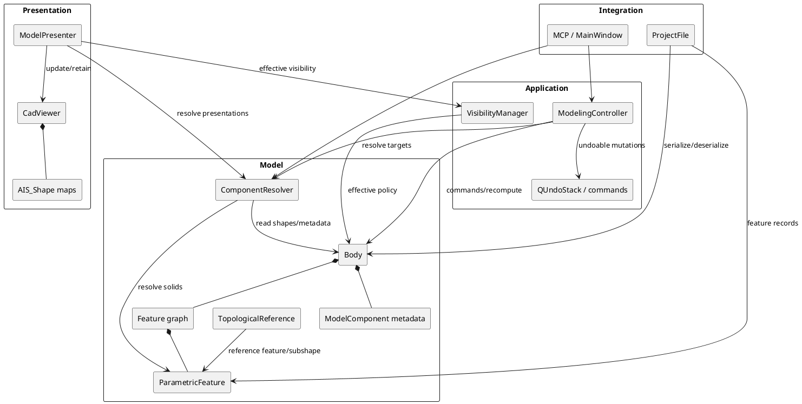
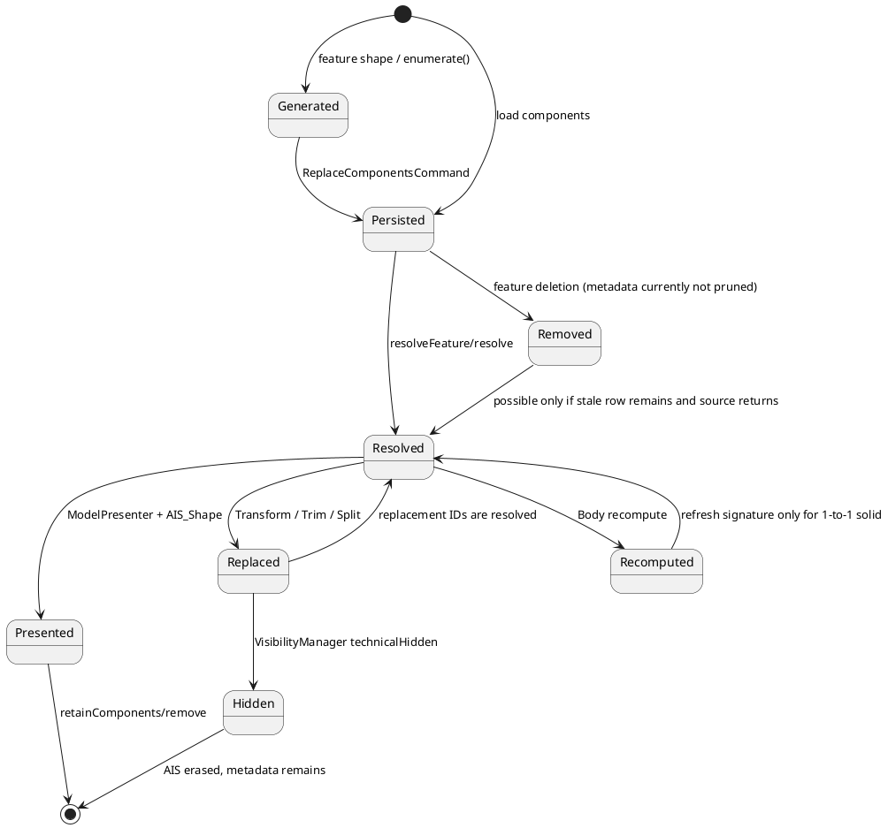

# ParametricCAD — Component Lifecycle & Identity Architecture Audit

**Дата аудита:** 2026-10-31
**Область:** статический анализ исходного кода, существующих тестов и отчётов.
**Ограничение:** production-код, формат `.pcad` и файлы в `examples/` не изменялись. Сценарии A–F не запускались интерактивно в рамках этого аудита; ниже явно отделены факты кода от непроверенных гипотез.

## 1. Executive Summary

ParametricCAD не имеет единого источника истины для компонента. Текущая модель распределена между:

- `Body::components_` — сохранённые metadata, replacement-связи и пользовательская видимость;
- `ParametricFeature::shape()` — текущая геометрия feature graph;
- `ComponentResolver` — вычисляемое сопоставление solid ↔ metadata;
- `VisibilityManager` — эффективная политика отображения;
- `CadViewer`/`ModelPresenter` — AIS-кэш и reconciliation.

Недавнее объединение сохранённых и вычисляемых metadata в `ModelingController::componentMetadata()` исправляет конкретный случай Trim, но не является полной унификацией: для feature с хотя бы одной сохранённой записью автоматические компоненты больше не добавляются (`src/application/ModelingController.cpp:90-101`).

Главный вывод: **самостоятельный `ComponentRegistry` сейчас не оправдан**. Нужна поэтапная унификация существующего `ComponentResolver` и усиление инвариантов в `Body`/командах. Registry следует рассматривать только после появления требований, которые нельзя безопасно выразить через resolver: централизованные mutation transactions, полноценная replacement-DAG, provenance и диагностика. Сейчас новый registry увеличил бы поверхность миграции, не устранив автоматически проблему stale metadata.

Подтверждённые проблемы:

1. Удаление feature не удаляет его component metadata: `Body::removeFeature()` изменяет только `features_` и `resultShape_` (`src/model/Body.cpp:103-123`), а `RemoveFeatureCommand` не сохраняет/не восстанавливает `components_` (`src/commands/FeatureCommands.cpp:539-581`).
2. `ComponentResolver::enumerate()` может генерировать одинаковый ID для геометрически одинаковых solids: ID — строка `featureId + bounds + volume`, без ordinal/collision policy (`src/model/ModelComponent.cpp:36-43,66-94`).
3. `ComponentResolver::resolve()` разрешает технически заменённый компонент; replacement-флаги учитываются visibility-политикой, но не самим resolver (`src/model/ModelComponent.cpp:160-183`, `src/application/VisibilityManager.cpp:684-701`).
4. `componentMetadata()` смешивает persisted и generated state по `sourceFeatureId`, поэтому partial metadata внутри одной feature не дополняется (`src/application/ModelingController.cpp:90-101`).
5. `Body::refreshComponentGeometry()` обновляет signature только при однозначном 1→1 сопоставлении (`src/model/Body.cpp:229-245`); при split/multi-solid изменения metadata не выводятся из текущей геометрии.

При этом AIS lifecycle имеет защитные механизмы: component и feature presentation взаимоисключаются, а `retainComponents()` удаляет неактуальные AIS (`src/viewer/CadViewer.cpp:2208-2248,2876-2888`). Поэтому дублирование AIS не доказано как постоянная утечка; риск возникает из-за разных списков источников истины и stale metadata.

## 2. Текущая архитектура и ответственность

| Класс/слой | Component ID | Metadata | Текущая геометрия | Active/replaced | Visibility | AIS | Persistence |
|---|---|---|---|---|---|---|---|
| `Body` | хранит строки в `components_` | владеет вектором metadata | `resultShape_`, feature shapes | не вычисляет | нет | нет | косвенно |
| `ParametricFeature` | feature ID, не component ID | хранит snapshot component в component-operation features | `shape_`, `build()` | через `hiddenDependencyIds()`/metadata косвенно | `userVisible_` | нет | `serialize()` |
| `ComponentResolver` | генерирует signature ID или использует persisted ID | читает `Body::components()` | находит solids в feature shape | не фильтрует replacement | нет | нет | нет |
| `ModelingController` | UUID feature ID; operation result ID = `featureId:component` | строит before/after metadata | создаёт component features | помечает parent hidden/replaced | делегирует | нет | через commands |
| `VisibilityManager` | component ID в policy maps | component modes/isolation | нет | `technicalHidden`/replacement имеют precedence | вычисляет effective mode | нет | visibility metadata |
| `ModelPresenter` | передаёт resolver ID в viewer | читает metadata | resolver shape | скрывает через effective visibility | применяет policy | вызывает viewer | нет |
| `CadViewer` | ключ `componentObjects_` | presentation mode cache | AIS_Shape shape | не знает replacement semantics | AIS visibility | создаёт/обновляет/удаляет AIS | нет |
| `ProjectFile` | сериализует ID и parent/replacements | сериализует `components` | feature payload/parameters | восстанавливает metadata | восстанавливает visibility manager | не сериализует AIS | load атомарно заменяет Body |
| MCP/MainWindow | принимает/возвращает component ID | иногда materializes generated metadata | вызывает controller/resolver | не имеет отдельной модели | вызывает visibility manager | refreshModelView | через ProjectFile |

### Диаграмма классов и ответственности

## 3. Identity and ComponentResolver

### ID creation and determinism

There are two identity regimes:

1. Explicit operation results use a random UUID feature ID (`src/application/ModelingController.cpp:41-45`) and append `:component` (`src/application/ModelingController.cpp:1890-1896,1947-1950,2011-2013`). These IDs are stable across recompute and save/load because feature IDs and component rows are serialized.
2. Legacy/implicit components use a deterministic metric signature (`src/model/ModelComponent.cpp:36-43`). It is stable only while the feature ID and all measured bounds/volume remain within the exact formatted values. Geometry edits can therefore change the generated ID; equal solids can collide.

`enumerate()` first returns all persisted records for a feature and otherwise enumerates current solids (`src/model/ModelComponent.cpp:66-94`). It does not merge records one-by-one, assign stable ordinals, detect collisions, or persist generated records. `resolveFeature()` matches each metadata record to the first candidate with equal metrics and suppresses a candidate when another later candidate has the same metrics (`src/model/ModelComponent.cpp:97-157`). This is conservative for ambiguity but loses addressability rather than reporting a structured conflict.

`resolve()` first trusts a matching persisted ID, then resolves all features for legacy/generated IDs (`src/model/ModelComponent.cpp:160-183`). It does not reject `technicalHidden`, non-empty `replacementComponentIds`, missing parents, or replacement cycles. The current visibility policy hides such components later; MCP `get_component` can still resolve and inspect them (`src/viewer/MainWindow.cpp:1125-1152`).

### Recent `componentMetadata()` change

The method starts with all persisted rows, records only persisted source feature IDs, and enumerates only features absent from that set (`src/application/ModelingController.cpp:90-101`). This prevents the old all-or-nothing failure when `Body::components()` is non-empty, and fixes the tested Trim path, but it has three limits:

- partial metadata for one feature suppresses all generated siblings;
- stale metadata for a deleted feature is retained in the returned vector;
- it does not canonicalize replacement chains or deduplicate by ID.

No mutation occurs in this helper itself. Side effects appear in callers that use the returned vector to commit `ReplaceComponentsCommand`; MCP visibility has a separate path that directly materializes generated metadata (`src/viewer/MainWindow.cpp:1162-1196`). Thus GUI/controller and MCP do not currently share one materialization path.

## 4. Component lifecycle

The lifecycle has four distinct states, which must not be conflated:

- **exists in Document/Body:** feature or metadata row is present;
- **active:** currently usable physical result after replacement filtering;
- **visible:** effective policy is not hidden;
- **presented:** an AIS object exists in `CadViewer`.

The code correctly separates visibility from technical replacement in `VisibilityManager::effectiveComponentVisibility()` (`src/application/VisibilityManager.cpp:684-701`). However, “active” is not a first-class resolver result; MCP derives it by iterating all `Body::components()` and dropping only components whose effective mode is hidden (`src/viewer/MainWindow.cpp:1233-1248`).

## 5. Operation audit

| Operation | Actual behavior | Identity/replacement result | Confidence |
|---|---|---|---|
| Extrude | creates a normal parametric feature through `addFeature`; component is implicit until enumerated | generated metric ID, or explicit metadata if later materialized | code-confirmed |
| Transform feature | adds `TransformFeature`; ReplaceResult hides source features by feature visibility (`src/application/ModelingController.cpp:1826-1871`) | not a component replacement record | code-confirmed |
| Transform component | creates `ComponentTransformFeature`, result `featureId:component`, parent link; ReplaceResult marks source technical-hidden and points to result (`:1877-1916`) | new ID; old ID remains resolvable but hidden | code-confirmed |
| Trim Body | creates one `TrimBodyFeature` per target, sets old row replacement to new row (`:1978-2041`) | new ID per target; sequential Trim can target current result only if caller supplies it | code-confirmed |
| Split component | creates two independent `ComponentSplitFeature`s; old row points to both (`:1922-1975`) | old ID retained as replaced parent; branch IDs are random feature IDs plus suffix | code-confirmed |
| Boolean | creates normal Boolean feature with operand feature dependencies (`:2219-2244`) | operand visibility is feature-policy driven; no component replacement metadata is created here | code-confirmed |
| Hide/Show | changes `ModelComponent.visible` in MCP and policy maps; does not remove geometry (`src/viewer/MainWindow.cpp:1162-1196`) | identity unchanged | code-confirmed |
| Delete | removes feature and dependency closure; Body does not prune component rows | stale metadata can remain | confirmed defect |
| Undo/Redo | component operations use one `ModelTransaction` containing AddFeature + ReplaceComponents; undo restores vectors exactly (`src/application/ModelTransaction.h:15-60`, `src/commands/FeatureCommands.cpp:45-63`) | exact only for metadata snapshot; feature deletion does not snapshot component metadata | code-confirmed/defect |
| Save/Load | serializes feature parameters and component rows; loads rows before recompute, then atomically replaces Body (`src/model/ProjectFile.cpp:640-707,1311-1379`) | explicit IDs and replacement rows preserved; generated-only components are recreated from current metrics | code-confirmed |

### Replacement chain A → B → C → D+E

For component operations, A is a persisted row. Transform creates B and changes A to `technicalHidden=true`, `replacementComponentIds=[B]`. Trim on B creates C and changes B similarly. Split on C creates D/E and changes C to both. The old rows are not deleted; they are retained as historical metadata and hidden by policy. There is no generic chain traversal or cycle validation. `recoverPreSplit()` contains a special-purpose cleanup for downstream Split/Transform history (`src/application/ModelingController.cpp:2043-2103`), not a general replacement resolver.

Therefore the actual current rule is: replacement is represented by metadata flags and visibility precedence, not by a canonical “current component” query. A stale ID can still be passed to `resolve()`; it is hidden only when a caller asks for effective visibility. Removing an intermediate feature is guarded by feature dependencies, but metadata cleanup is not coupled to that removal.

## 6. Feature Graph and TopologicalReference

`Body` recomputes features in insertion/dependency order and propagates dirty state by weak dependency traversal (`src/model/Body.cpp:177-226,248-259`). `ParametricFeature::recompute()` recomputes dependencies before `build()` and increments a feature geometry revision (`src/model/ParametricFeature.cpp:175-210`). This is consistent for feature geometry, but component identity is not part of the graph: component-operation features copy a `ModelComponent` snapshot and resolve its geometry using bounds/volume (`src/operations/ParametricFeatures.cpp:3430-3465,3545-3572,3873-3945`).

The Sketch → Extrude → Trim #1 → Trim #2 → Transform chain is therefore graph-correct only if each downstream feature retains a resolvable source feature and its metric snapshot still matches exactly one solid. `TopologicalReference` is a separate subshape-reference mechanism: it stores feature ID plus transient index/signature/semantic ID and resolves against the current feature shape (`src/model/TopologicalReference.h:59-70,112-138; src/model/TopologicalReference.cpp:550-645`). It does not identify a component and cannot repair a component replacement chain.

Confirmed consistency gap: recompute updates component bounds/volume only for one source component and one current solid (`src/model/Body.cpp:229-245`). For multi-solid/split results, metadata signatures are not refreshed from the rebuilt shape. Potential consequence: after an upstream Sketch edit, a component can become unresolved or acquire a changed generated ID; this is a risk, not a demonstrated runtime failure in this audit.

## 7. AIS Presentation lifecycle

`ModelPresenter::refreshModel()` recomputes Body, resolves component solids, creates/updates component AIS, and calls `retainFeatures()`/`retainComponents()` (`src/viewer/ModelPresenter.cpp:43-125`). For a feature with component records it presents components only, not the feature and children simultaneously (`:91-106`). `CadViewer::updateComponent()` reuses an AIS object by component ID and updates its shape; an empty shape removes it (`src/viewer/CadViewer.cpp:2208-2255`). Stale component AIS objects are removed by `retainComponents()` (`:2876-2888`), and project load explicitly clears/reconciles viewer state (`src/viewer/MainWindow.cpp:7338-7346`).

Selection maps AIS object identity back to component ID by map lookup (`src/viewer/SelectionAdapter.cpp:38-45`). This is stable while the map is synchronized, but it is not a persistent identity and does not resolve replacement ancestry. A stale selection can therefore survive at the UI boundary until refresh/selection restoration rejects it.

Assessment:

- stale AIS accumulation: **mitigated in normal refresh**, not proven as a leak;
- feature + component duplicate AIS: **explicitly guarded** by `updateComponent()` and retain passes;
- replaced component displayed: **hidden by policy if metadata is present**, but resolver still returns it;
- AIS → component mismatch: **possible during transitions**, especially when metadata is materialized through different paths; no direct reproducible case established here;
- preview mutation: trim preview creates temporary feature and shape only, with no `Body` command; no persistent mutation is visible in `MainWindow.cpp:2388-2420`.

## 8. Confirmed defects vs potential risks

### Confirmed by source inspection

| ID | Finding | Evidence | Impact |
|---|---|---|---|
| C-1 | Feature deletion leaves component metadata | `Body::removeFeature()` and `RemoveFeatureCommand` above | stale rows, counts, policy entries, unresolved IDs |
| C-2 | Generated ID collision for equal solids | metric-only `idFor()` | duplicate IDs or unaddressable solids |
| C-3 | Resolver does not encode “active” | `resolve()` ignores technicalHidden/replacements | replaced IDs remain API-resolvable |
| C-4 | Partial metadata is not merged | `componentMetadata()` groups only by source feature | missing sibling/generated components |
| C-5 | GUI/controller/MCP have separate materialization paths | controller helper vs MCP `set_component_visibility` | divergent metadata behavior |

### Potential risks requiring runtime regression coverage

| Risk | Why plausible | Not proven because |
|---|---|---|
| 20 transforms accumulate duplicate geometry | old features remain in graph and old metadata remain | presenter hides replaced components and retains AIS |
| replacement chain resurrects after Save/Load | resolver can resolve historical rows and load preserves rows | visibility policy normally suppresses them |
| IDs change after upstream geometry edit | generated ID includes bounds/volume | explicit operation IDs are stable; no A–F runtime run here |
| Split branches lose metadata after recompute | refresh only handles 1→1 geometry | existing MCP reports show split persistence passing for tested fixture |
| Undo/Redo leaves stale component rows after delete | delete command does not snapshot component vector | no delete-after-component runtime test run |

## 9. Existing evidence and scenarios

The repository already contains useful evidence: `tests/trim_body_tests.cpp:91-137` covers parametric trim, save/load and generated metadata; `tests/mcp_modeling_integration_tests.cpp:428-504` covers split, save/load, component inspection and presentation counts; `docs/mcp/CAD_COMPONENTS_1C_LIVE_REPORT.md:44-79` reports split persistence and stable IDs for its fixture; `tests/project_file_tests.cpp:290-341` covers `examples/house_facade_photo.pcad` and trim metadata.

The requested scenarios A–F were not executed as new experiments. The required regression matrix below is the recommended next verification step and must not modify `examples/house_facade_photo.pcad`.

## 10. Architectural options

| Option | Scope/complexity | Serialization | Feature Graph impact | Compatibility | Risk | Assessment |
|---|---|---|---|---|---|---|
| A. Focused fixes | `Body`, resolver, delete command, tests; smallest | none or additive validation | none | strongest | lowest | immediate baseline |
| B. Extend `ComponentResolver` | make one resolver return canonical records, active/replaced state, chain diagnostics and materialization | additive metadata rules possible | low | good if legacy fallback remains | medium | recommended target |
| C. New `ComponentRegistry` | move identity, current geometry, chain mutation and metadata ownership out of Body/controller | likely schema/migration work | medium/high | highest migration burden | highest | premature today |

Option A should first establish invariants and diagnostics. Option B can then consolidate all existing call sites (`ModelingController`, `ModelPresenter`, MCP, visibility inspection) without inventing another owner. Option C becomes justified only if replacement mutations, persistence migration and cross-document identity need transactionally centralized state that resolver cannot provide.

## 11. Recommended target architecture

Use an **expanded canonical ComponentResolver**, while keeping `Body::components()` as persisted storage during migration:

1. `enumerate()` returns a canonical record per current solid, merges metadata per component/ID rather than per source feature, and reports collisions/ambiguity explicitly.
2. `resolve()` returns a status containing `current`, `replaced`, `hidden`, `missing-source`, or `ambiguous`; callers must not infer active state from visibility.
3. Add read-only chain traversal with cycle/dangling-reference diagnostics; do not delete historical rows implicitly.
4. Centralize generated-metadata materialization behind one controller/resolver API used by GUI and MCP.
5. Make `Body` validate component rows against feature existence and unique IDs at mutation boundaries; pair feature deletion with metadata snapshot/pruning in the same undo command.
6. Keep `TopologicalReference` separate: it resolves subshapes, not component identity.
7. Make presenter consume canonical active records and send only that set to AIS retention.

This is a recommendation for a later implementation phase, not an implementation in this audit.

## 12. Proposed invariants and current enforcement

| Invariant | Current enforcement |
|---|---|
| Active component IDs are unique | `Body::replaceComponents()` checks persisted IDs; generated enumeration does not fully enforce it |
| One ID cannot denote two active details | not guaranteed for equal metric-generated solids |
| Replaced component is excluded from active result | visibility manager hides it; resolver/API still returns it |
| Hidden ≠ deleted | generally enforced by `visible`/visibility policy separation |
| Undo/Redo restores coherent feature + component state | component transactions do; feature deletion does not restore metadata |
| Save/Load preserves semantic explicit IDs | yes for serialized component rows; generated IDs depend on metrics |
| AIS shows only canonical current geometry | presenter retention mitigates; no canonical active resolver result |
| Preview does not mutate Document | current trim preview uses temporary feature and no command |
| GUI and MCP use same resolution | both call resolver for operations, but metadata materialization differs |
| Recompute is idempotent | feature recompute is intended idempotent; component metadata refresh is partial |
| Replacement references are existing and acyclic | not validated centrally |
| Component source feature exists | checked on `replaceComponents`; stale rows can remain after feature deletion |

## 13. Migration plan (small independent stages)

1. Add read-only diagnostics for duplicate IDs, missing sources, dangling replacements, cycles, partial metadata and unresolved signatures.
2. Add tests for C-1…C-5 and the requested A–F scenarios using temporary projects only.
3. Introduce canonical resolver result/status without changing serialized format or MCP API.
4. Route controller, presenter and MCP inspection/materialization through that result.
5. Make delete/undo capture component state and prune only metadata whose source feature is actually removed.
6. Define collision policy for generated IDs; preserve legacy IDs on load and write new IDs only for newly materialized records.
7. Add recompute reconciliation for multi-solid results and explicit replacement-DAG validation.
8. Reassess whether a registry is still necessary after measuring call-site reduction and mutation complexity.

No stage should silently change replacement semantics or rewrite existing `.pcad` files.

## 14. Regression matrix

| Scenario | Assertions | Current source/tests | Status in this audit |
|---|---|---|---|
| A. 20 repeated transforms | feature count, metadata count, active IDs, AIS count; no old active geometry | controller transform + presenter | not run |
| B. repeated trims | each result resolves, old rows hidden, no duplicate visible solids | trim tests and controller | not run as new experiment |
| C. split → transform → undo/redo | both branch IDs survive; parent excluded; AIS count returns exactly | MCP split integration | existing fixture evidence; new chain not run |
| D. partial metadata | merge per solid, no duplicate IDs, stable result set | `componentMetadata()` and MCP path | static defect confirmed; runtime not run |
| E. save/load | IDs, parent/replacement graph, active geometry and AIS counts equal | ProjectFile + MCP reports | partial existing evidence |
| F. upstream Sketch edit | downstream recompute order, references, component resolution and AIS update | Body dirty propagation + trim tests | not run for full chain |
| house facade regression | `examples/house_facade_photo.pcad` loads, trim target resolves, no example modification | `tests/project_file_tests.cpp:290-341` | existing test coverage |

## 15. Final answer to the main question

**Достаточно расширения и унификации существующего `ComponentResolver`; самостоятельный `ComponentRegistry` на текущем этапе не нужен.**

The evidence points to missing canonical resolution and validation, not to an unavoidable need for a new owner. The first implementation milestone should be a resolver contract that distinguishes persisted, generated, active, replaced and ambiguous states, followed by command-level cleanup and regression tests. Revisit a registry only if those changes leave replacement mutation and persistence ownership distributed in a way that cannot be made consistent without a new transaction boundary.
